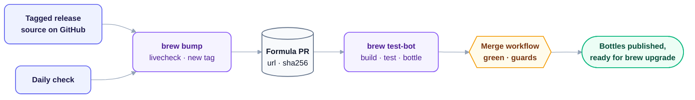

<p align="center">
  <picture>
    <source media="(prefers-color-scheme: dark)" srcset="assets/brand/hero-dark.png">
    
  </picture>
</p>

<p align="center">
  <b>Orin DX tools, ready for your terminal.</b>
</p>

<p align="center">
  <a href="https://github.com/orin-dx/homebrew-tap/actions/workflows/tests.yml"></a>
  <a href="LICENSE"></a>
</p>

---

## Pick a tool

This tap is for published command-line binaries. You can install one tool without installing the others; libraries, plugins, and planned products stay in their own package channels until they have a CLI release that fits Homebrew.

| Tool | Job | Install |
| --- | --- | --- |
| [Callisto](docs/tools/callisto.md) | Plan versions and coordinate Cargo, npm, and PyPI releases. | `brew install orin-dx/tap/callisto` |
| [Caliper](docs/tools/caliper.md) | Extract React props for docs and CI. | `brew install orin-dx/tap/caliper` |

Each tool guide has a useful first workflow, integration notes, and links to its full project docs. When another CLI joins, it gets one row here and one guide. The tap itself stays focused on installation and updates.

Homebrew downloads a prebuilt bottle for your platform, so you do not need Rust, Cargo, or a compiler. If no bottle matches your system, Homebrew builds the tagged release from source, which installs Rust and takes several minutes. `brew install --build-from-source` forces that build.

## Where it runs

The tap's CI builds, tests, and bottles each formula on these systems:

| Platform | CI runner |
| --- | --- |
| macOS Apple Silicon | macOS 26 ARM64 |
| Linux ARM64 | Homebrew's Ubuntu container, ARM64 |
| Linux x86-64 | Homebrew's Ubuntu container, x86-64 |

**Intel Macs are not supported.** Homebrew publishes no Intel macOS bottles, so installing a Rust tool there would compile the Rust toolchain from source first. The formulae refuse to install on Intel macOS and say so, rather than start a very long build. Other systems without a matching bottle fall back to a source build.

### Older releases

Older breaking lines of a tool stay available as versioned formulae, such as `brew install orin-dx/tap/callisto@0.15` or `callisto@0.14`. Before 1.0 each minor version is its own line; from 1.0 each major version is. A versioned formula receives patch releases for its line only and is keg-only, so it does not link into your `PATH` unless you run `brew link`. A line is removed only when its upstream project stops supporting it.

### Check or update an install

```sh
callisto --version
caliper-docgen --version
brew info orin-dx/tap/callisto
brew info orin-dx/tap/caliper
brew update
brew upgrade orin-dx/tap/callisto
brew upgrade orin-dx/tap/caliper
```

Run only the commands for the tools you installed. `brew info` shows the formula version Homebrew knows about; `--version` reports the CLI you are actually running. A new upstream release reaches this tap after its formula PR is checked and merged and its bottles are published, so the two versions can briefly differ.

The fully qualified `brew install orin-dx/tap/<tool>` command asks Homebrew to use this tap's formula. Review [Homebrew's tap trust guide](https://docs.brew.sh/Tap-Trust) if Homebrew asks you to trust the tap.

## How an update gets here

Each formula builds a tagged release of the tool from source. Homebrew's own tooling follows new tags and publishes the bottles.



Each formula's `livecheck` block says which upstream tags count as releases. The daily **brew bump** workflow runs `brew bump`, which opens a PR that changes the source URL and SHA-256. **brew test-bot** builds, tests, and bottles the change on every platform above. The release was already reviewed upstream, so the **merge release bumps** workflow merges the PR once CI passes and the PR only moves the source URL and checksum. The **brew pr-pull** workflow then publishes the bottles and checks that each formula installs from one. When a tool crosses into a new breaking line, the previous line is kept as a versioned formula automatically.

On installation, Homebrew checks the pinned SHA-256 of the source tarball or bottle. That catches mismatched files; it cannot prove the upstream repository was uncompromised. [How automation works](docs/automation.md) explains the trust boundary, App permissions, and recovery path.

## If something goes wrong

| What you see | First check |
| --- | --- |
| Homebrew cannot find the formula | Use the full name, such as `orin-dx/tap/caliper`, then run `brew update`. Check [formula CI](https://github.com/orin-dx/homebrew-tap/actions/workflows/tests.yml) if it is a fresh release. |
| Homebrew asks whether to trust this tap | Read the [tap trust guide](https://docs.brew.sh/Tap-Trust) and the formula you are about to install. The prompt is Homebrew's normal trust decision for a third-party tap. |
| Download, checksum, or install fails | Check `brew info orin-dx/tap/<tool>` and retry after `brew update`. [Open a tap issue](https://github.com/orin-dx/homebrew-tap/issues/new) with OS, CPU, Homebrew version, and the failing output. |
| The install compiles Rust instead of downloading a bottle | No bottle matches your OS and CPU, or the release's bottles are not published yet. Wait for the release's bottles or [open a tap issue](https://github.com/orin-dx/homebrew-tap/issues/new) with your OS and CPU. |
| Caliper CLI works, but Storybook has no prop docs | Install and configure the version-appropriate [Storybook integration](https://github.com/orin-dx/caliper#storybook) in your project; the Homebrew formula installs only the CLI. |
| The CLI runs, but its behavior looks wrong | Report the behavior in [Callisto](https://github.com/orin-dx/callisto/issues) or [Caliper](https://github.com/orin-dx/caliper/issues). |

## Work on the tap

The [formulas](Formula/) tell Homebrew how to build each tool, and the [workflows](.github/workflows/) are Homebrew's standard tap workflows. [Contributing](CONTRIBUTING.md) shows how to update a formula or add another tool; Firkin can join once it has tagged source releases. [Security](SECURITY.md) tells you how to report a sensitive issue privately.

The tap's files are [MIT licensed](LICENSE). The installed Callisto and Caliper binaries keep their own [upstream](https://github.com/orin-dx/callisto/blob/main/LICENSE) [licenses](https://github.com/orin-dx/caliper/blob/main/LICENSE).
