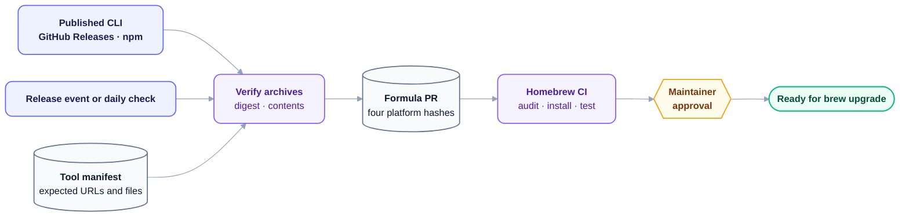

<p align="center">
  <picture>
    <source media="(prefers-color-scheme: dark)" srcset="assets/brand/hero-dark.png">
    
  </picture>
</p>

<p align="center">
  <b>Orin DX tools, ready for your terminal.</b>
</p>

<p align="center">
  <a href="https://github.com/orin-dx/homebrew-tap/actions/workflows/ci.yml"></a>
  <a href="LICENSE"></a>
</p>

---

## Pick a tool

This tap is for published command-line binaries. You can install one tool without installing the others; libraries, plugins, and planned products stay in their own package channels until they have a CLI release that fits Homebrew.

| Tool | Job | Install |
| --- | --- | --- |
| [Callisto](docs/tools/callisto.md) | Plan versions and coordinate Cargo, npm, and PyPI releases. | `brew install orin-dx/tap/callisto` |
| [Caliper](docs/tools/caliper.md) | Extract React props for docs and CI. | `brew install orin-dx/tap/caliper` |

Each tool guide has a useful first workflow, integration notes, and links to its full project docs. When another CLI joins, it gets one row here and one guide. The tap itself stays focused on installation and updates.

Homebrew downloads a published binary for your platform. You do not need Rust, Cargo, or a compiler to install it.

## Where it runs

Each formula picks one archive for your OS and CPU. These are the combinations the tap tests:

| Platform | CI runner |
| --- | --- |
| macOS Apple Silicon | macOS 15 ARM64 |
| macOS Intel | macOS 15 x86-64 |
| Linux ARM64 | Ubuntu 24.04 ARM64 |
| Linux x86-64 | Ubuntu 24.04 x86-64 |

Linux archives target GNU/Linux with glibc. Other distributions and older glibc versions are outside the tap's CI coverage. The formula uses prebuilt archives; it does not compile a fallback binary from source.

### Check or update an install

```sh
callisto --version
caliper-docgen --version
brew info orin-dx/tap/callisto
brew info orin-dx/tap/caliper
brew update
brew upgrade orin-dx/tap/callisto
brew upgrade orin-dx/tap/caliper
```

Run only the commands for the tools you installed. `brew info` shows the formula version Homebrew knows about; `--version` reports the CLI you are actually running. A new upstream release reaches this tap after its formula PR is checked and merged, so the two versions can briefly differ.

The fully qualified `brew install orin-dx/tap/<tool>` command asks Homebrew to use this tap's formula. Review [Homebrew's tap trust guide](https://docs.brew.sh/Tap-Trust) if Homebrew asks you to trust the tap.

## How an update gets here

Callisto publishes CLI archives on GitHub Releases. Caliper publishes platform binaries on npm. This tap follows those releases through a reviewable formula change.



The release notification supplies only a tool name and tag. The tap chooses URLs from its committed [tool manifests](tools/), downloads all four archives, verifies each against the publisher's digest, and checks for the expected executable. It then pins SHA-256 values in a formula PR. CI audits, installs, and smoke-tests the changed formulas on all four runners; a weekly full run checks the whole catalog. A maintainer reviews each update before merge. A daily check catches releases whose notification was missed.

On installation, Homebrew checks the pinned SHA-256 against the downloaded archive. These checks catch mismatched or unexpected files; they cannot prove the upstream publisher or its build process was uncompromised. [How automation works](docs/automation.md) explains the trust boundary, App permissions, and recovery path.

## If something goes wrong

| What you see | First check |
| --- | --- |
| Homebrew cannot find the formula | Use the full name, such as `orin-dx/tap/caliper`, then run `brew update`. Check [formula CI](https://github.com/orin-dx/homebrew-tap/actions/workflows/ci.yml) if it is a fresh release. |
| Homebrew asks whether to trust this tap | Read the [tap trust guide](https://docs.brew.sh/Tap-Trust) and the formula you are about to install. The prompt is Homebrew's normal trust decision for a third-party tap. |
| Download, checksum, or install fails | Check `brew info orin-dx/tap/<tool>` and retry after `brew update`. [Open a tap issue](https://github.com/orin-dx/homebrew-tap/issues/new) with OS, CPU, Homebrew version, and the failing output. |
| The command fails on Linux | Check whether your distribution provides glibc compatible with the published GNU/Linux binary. Include the distribution and glibc version in a tap issue. |
| Caliper CLI works, but Storybook has no prop docs | Install and configure the version-appropriate [Storybook integration](https://github.com/orin-dx/caliper#storybook) in your project; the Homebrew formula installs only the CLI. |
| The CLI runs, but its behavior looks wrong | Report the behavior in [Callisto](https://github.com/orin-dx/callisto/issues) or [Caliper](https://github.com/orin-dx/caliper/issues). |

## Work on the tap

The [formulas](Formula/) tell Homebrew what to install. The [tool manifests](tools/) describe the expected upstream archives, and the [updater](scripts/update_formula.py) turns a verified release into a formula diff. [Contributing](CONTRIBUTING.md) shows how to update a formula or add another tool; Firkin can join once it publishes suitable platform binaries. [Security](SECURITY.md) tells you how to report a sensitive issue privately.

The tap's files are [MIT licensed](LICENSE). The installed Callisto and Caliper binaries keep their own [upstream](https://github.com/orin-dx/callisto/blob/main/LICENSE) [licenses](https://github.com/orin-dx/caliper/blob/main/LICENSE).
