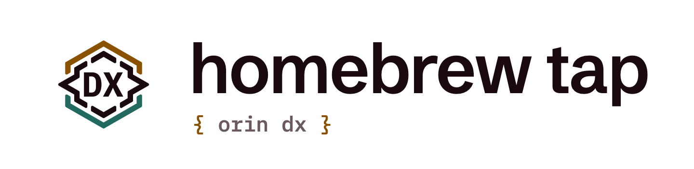

  <picture>
    <source media="(prefers-color-scheme: dark)" srcset="assets/brand/hero-dark.png">
    
  </picture>

<h1 align="center">Security policy</h1>

## Report privately

If an issue could affect someone's machine or the tap's release process, please don't open a public issue first. Use GitHub's **Report a vulnerability** option in this repository's Security tab, or email **security@orin-dx.com**.

Tell us which formula or workflow is affected, what an attacker could do, and how to reproduce it if you can. Please don't include live credentials. Expect an acknowledgment within five business days. We'll share progress during triage and credit you when a fix ships unless you'd prefer otherwise.

## What belongs here

This tap is executable packaging code. Homebrew evaluates a formula before installing its binary, so a compromised formula or update workflow can harm users even when the CLI itself is sound.

- **Install path:** an archive or formula that runs unexpected code, installs the wrong binary, crosses an architecture boundary, or bypasses its pinned checksum.
- **Update path:** a forged release signal that makes the updater accept an unverified URL, digest, archive member, or downgrade; a parser or workflow flaw that turns release data into code execution.
- **Credentials and review:** exposure of the GitHub App key or token, an untrusted PR reaching those credentials, or a way for the App to bypass review and write to `main`.

If the bug is in Callisto's or Caliper's CLI rather than its packaging, report it to that project's security contact. If a published archive itself looks compromised, report it here too so we can stop distributing it.

## What the checks cover

Formula URLs are versioned and carry SHA-256 values. Before an automated update, the tap compares each downloaded archive with its publisher's GitHub SHA-256 or npm SHA-512 integrity value and checks its expected contents. CI audits, installs, and runs a smoke test for each macOS and Linux target. The GitHub App is installed only on this tap; a maintainer approves formula PRs.

Those checks do not prove that the publisher's account, build process, or binary is safe. The published digest and archive come from the same upstream. A credible upstream compromise is in scope for a private report even if every checksum matches.

## Supported versions

Security fixes go to `main` and the latest formula for each tool. We do not backport tap fixes to older formula revisions. Callisto and Caliper each define support for their own releases in their repositories.
